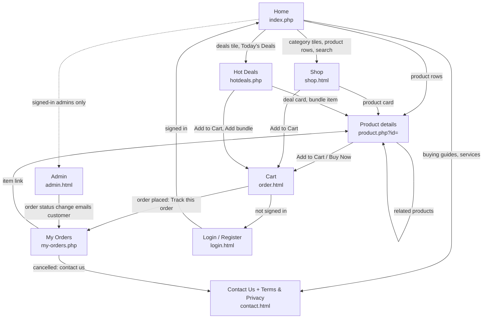

# Site Map

How the pages link together. The header (logo, search, Menu, Home, Shop, Contact Us, Hot Deals, cart, account links) and the footer (quick links, categories, Terms, Privacy) are on every page, so every page can reach Home, Shop, Contact Us, Hot Deals and the Cart directly.

## Menu shortcuts (header "Menu" on every page)

| Menu item | Goes to |
|---|---|
| Shell Shocker, Clearance Deals, Email Deals | Hot Deals sections (`#shell-shocker`, `#clearance`, `#email-deals`) |
| Trade In, Server / NAS | Contact Us with the subject chosen |
| Desktop PC, Workstation, Home Network, Game Room | Shop filtered to the matching category |
| Each product category, Shop All | Shop filtered to that category / everything |
